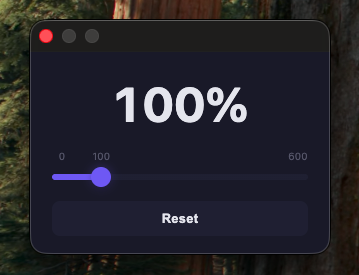

# Simple Volume Control

<p align="center">
  
</p>

<p align="center">
  <strong>タブの音量をシンプルに制御する Chrome 拡張機能</strong>
</p>

<p align="center">
  
  
  
</p>

<p align="center">
  <strong>日本語</strong> | <a href="README.en.md">English</a>
</p>

---

## ✨ 特徴

- **シンプルな UI** — 音量スライダーとリセットボタンだけのミニマルデザイン
- **0% 〜 600% の音量制御** — ブースト / 減衰をワンスライダーで
- **タブ音声全体を制御** — `tabCapture` + Web Audio API により、サイト実装に依存しない安定した制御
- **ダークテーマ** — 見やすく洗練された UI

## 📸 スクリーンショット

<p align="center">
  
</p>

## 🎯 こんなときに便利

- YouTube の動画ごとの音量差が気になる
- 音が小さいサイトの音声をブーストしたい
- 既存の音量拡張が多機能すぎて使いにくい

## 🛠 技術構成

```
popup (UI)
  ↓ メッセージ送信
service_worker
  ↓ stream ID 発行 / 状態管理
offscreen document
  ↓
Web Audio API (GainNode → AudioDestination)
```

| 技術 | 用途 |
|---|---|
| Manifest V3 | Chrome 拡張の基盤 |
| tabCapture API | タブ音声のキャプチャ |
| Offscreen Document | バックグラウンドでの音声処理 |
| Web Audio API (GainNode) | 音量の倍率制御 |

## 📁 ファイル構成

```
Simple-Volum-Control/
├── manifest.json          # 拡張機能の設定
├── service_worker.js      # バックグラウンド処理・タブ管理
├── offscreen.html         # Offscreen Document (HTML)
├── offscreen.js           # 音声処理 (Web Audio API)
├── popup/
│   ├── popup.html         # ポップアップ UI
│   ├── popup.css          # スタイル (ダークテーマ)
│   └── popup.js           # UI ロジック
└── icons/
    ├── icon16.png
    ├── icon48.png
    └── icon128.png
```

## 🚀 インストール方法

1. このリポジトリをクローンまたはダウンロード
   ```bash
   git clone https://github.com/P0KEBAN/Simple-Volum-Control.git
   ```
2. Chrome で `chrome://extensions/` を開く
3. 右上の **「デベロッパー モード」** を有効にする
4. **「パッケージ化されていない拡張機能を読み込む」** をクリック
5. クローンしたフォルダを選択

## 🧪 テスト

分離されたユニットテストは Node.js の標準機能だけを使用します。Chrome API と
Web Audio API はモック化されるため、実タブのキャプチャやブラウザプロファイルへの
アクセスは行いません。

```bash
node --test
```

## 💡 使い方

1. 音声再生中のタブで拡張アイコンをクリック
2. スライダーで音量を調整（0% 〜 600%）
3. `Reset` ボタンで 100% に戻す

### ⌨️ キーボード操作

| キー | 動作 |
|---|---|
| `Alt` + `Shift` + `V`（Mac: `Option` + `Shift` + `V`） | ポップアップを開く |
| `←` `→` `↑` `↓` | 音量を 5% ずつ調整 |
| `Shift` + 矢印 | 音量を 25% ずつ調整 |
| `0` 〜 `6` | 0% 〜 600% に直接設定（`0` はミュート、`1` は 100%） |
| `R` | 100% にリセット |
| `Esc` | ポップアップを閉じる |

ポップアップを開くキーは `chrome://extensions/shortcuts` で変更できます。他の拡張機能が同じキーを
使っている場合は自動では割り当てられないため、同じ画面から設定してください。

## ⚠️ 注意事項

- 一部のタブ（`chrome://` ページなど）では音量制御を開始できません
- 音量を大幅にブーストすると音割れが発生する場合があります
- 音量設定はセッション内のみ有効です（タブを閉じるとリセットされます）

## 🔧 必要な権限

| 権限 | 理由 |
|---|---|
| `tabCapture` | タブの音声ストリームを取得するため |
| `offscreen` | バックグラウンドで音声処理を行うため |
| `activeTab` | 現在のタブ情報にアクセスするため |

## 📄 ライセンス

MIT
